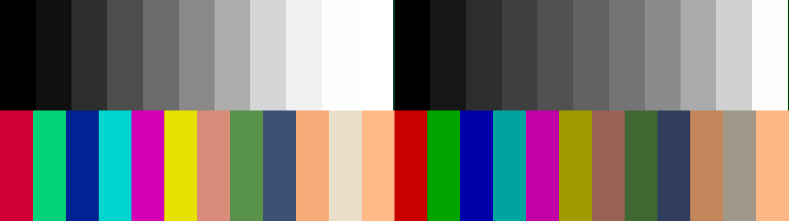
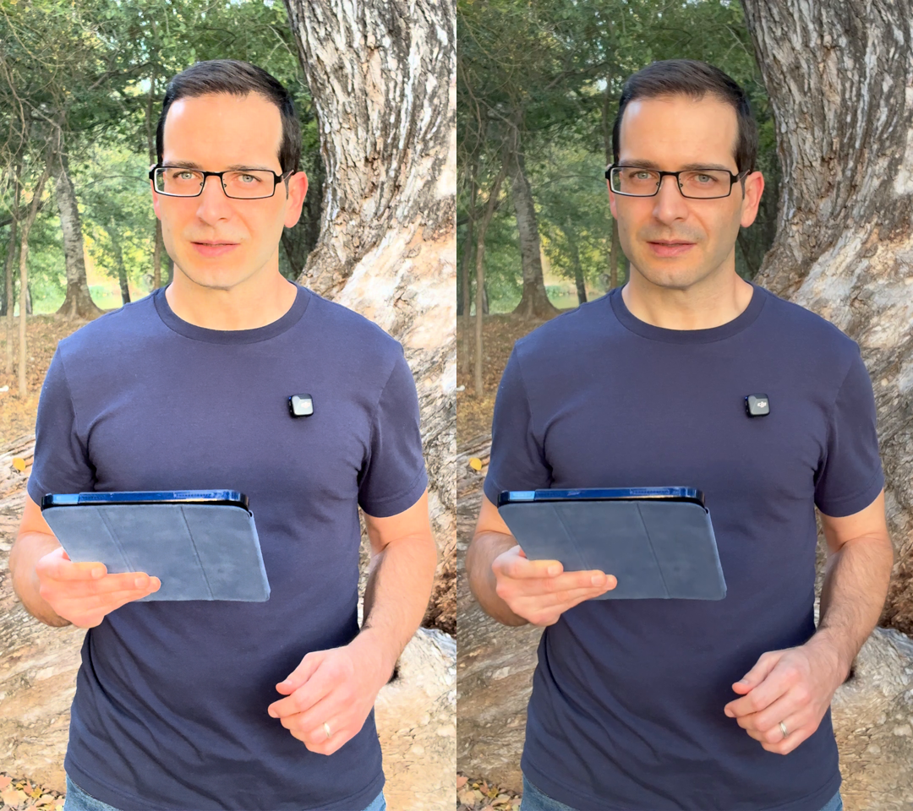

# FilmCraft HLG → SDR: measurements against Apple's conversion

Test pattern, repro script and measurements for the "iPhone HLG footage renders too bright in a Rec. 709
sequence" problem in [FilmCraft](https://github.com/storytold/filmcraft)
([issue #3305](https://github.com/storytold/filmcraft/issues/3305),
[PR #1273](https://github.com/storytold/filmcraft/pull/1273),
[PR #3312](https://github.com/storytold/filmcraft/pull/3312)).

Apple's own HDR → SDR conversion (AVFoundation, what Photos and QuickTime show) is used as the target, because
footage from an iPhone should look in the edit the way it looks on the phone.

## What is here

| Path | What it is |
|---|---|
| `sample/hlg_pattern.mov` + `.json` | Synthetic pattern: 1920×1080, 60 fps, 1 s, ProRes 422 HQ 10-bit, tagged BT.2020 / HLG (ARIB STD-B67) / BT.2020 NCL, limited range. Top row: 11 neutral steps at HLG signal 0–100 %. Bottom row: 12 colour patches (BT.2020 primaries at 75 %, and real-world colours). The JSON gives every patch's HLG R'G'B', exact 10-bit Y'CbCr codes and pixel box. No Dolby Vision metadata, so the comparison isolates HLG → SDR. |
| `make_pattern.py` | Regenerates the pattern (needs ffmpeg with `prores_ks`). |
| `repro.py` | One-command repro: builds a headless FilmCraft project with `filmcraft-cli` (default Rec. 709 sequence, `autoToneMap: true`, `wideGamut: false`), exports a PNG, renders the same frame with Apple's `avconvert` and two ffmpeg `zscale` conversions, and prints per-patch RGB into `out/results.json`. Needs `filmcraft-cli`, ffmpeg with zscale, and macOS for `avconvert`. If an iPhone HLG clip is placed at `sample/iphone_hlg_dv_4s.mov` it also measures regions of real footage. |
| `out/` | Results of the run on 2026-11-01 (FilmCraft 0.16.0, macOS 26.7.1): `results.json`, the pattern PNGs from each renderer, and side-by-side images. |
| `analysis/hlg_model.py` | Double-precision model of FilmCraft's HLG input transform on main, of PR 3312's BT.2446-1 Method A, and of the proposed BT.2100 OOTF curve, evaluated on the pattern and compared with `out/results.json`. Output in `analysis/model_output.txt`. |
| `analysis/filmcraft_probe.rs` | Integration test that runs FilmCraft's real `InputTransform` on the patches. Its output on main (`8c171a0a`) and on PR 3312 (`aaded55a`) is in `analysis/probe_*_output.txt`. |

## Reproduce

```sh
python3 repro.py                    # FilmCraft vs Apple vs ffmpeg on the pattern, writes out/
python3 -I analysis/hlg_model.py    # the models against out/results.json
```

## Results

All values are the mean 8-bit sRGB of the centre of each patch. "main" is the FilmCraft 0.16.0 export.
"PR 3312" is FilmCraft's `InputTransform` at that PR's head, run through `analysis/filmcraft_probe.rs` (the same
probe on main agrees with the export within 3 codes on every patch). "OOTF γ = 0.846" is the proposed curve,
modelled.



### Grey ramp (difference to Apple in brackets)

| HLG signal | Apple | main (0.16.0) | PR 3312 (BT.2446-1 A) | OOTF γ = 0.846 (model) |
|---|---|---|---|---|
| 10 % | 23 | 18 (-5) | 13 (-10) | 22 (-1) |
| 20 % | 45 | 47 (+2) | 37 (-8) | 45 (+0) |
| 30 % | 65 | 77 (+12) | 60 (-5) | 64 (-1) |
| 40 % | 81 | 108 (+27) | 80 (-1) | 82 (+1) |
| 50 % | 98 | 138 (+40) | 100 (+2) | 98 (+0) |
| 60 % | 116 | 174 (+58) | 123 (+7) | 116 (+0) |
| 70 % | 140 | 214 (+74) | 153 (+13) | 140 (+0) |
| 80 % | 172 | 241 (+69) | 189 (+17) | 171 (-1) |
| 90 % | 209 | 253 (+44) | 224 (+15) | 208 (-1) |
| 100 % | 253 | 255 (+2) | 255 (+2) | 255 (+2) |
| rms / worst | | 42 / 73 | 10 / 17 | 1 / 2 |

### Real-world colours (largest per-channel difference to Apple in brackets)

| Patch (HLG R'G'B') | Apple | main | PR 3312 | OOTF γ = 0.846 (model) |
|---|---|---|---|---|
| skin (.68,.55,.47) | 154,97,89 | 215,141,120 (61) | 160,105,93 (8) | 157,100,87 (3) |
| lit_skin (.81,.71,.56) | 195,134,88 | 249,168,120 (54) | 213,150,109 (21) | 199,136,94 (6) |
| foliage (.40,.52,.30) | 61,103,53 | 88,145,74 (42) | 67,106,57 (6) | 63,105,52 (2) |
| denim (.28,.31,.45) | 49,62,92 | 62,79,114 (22) | 50,62,89 (3) | 52,66,98 (6) |
| bark (.76,.75,.71) | 161,152,136 | 232,224,199 (72) | 177,170,155 (19) | 161,154,139 (3) |
| warm_hilite (.94,.86,.74) | 252,183,131 | 255,187,135 (4) | 255,202,153 (22) | 255,186,136 (5) |

### BT.2020 primaries at 75 %

| Patch | Apple | main | PR 3312 | OOTF γ = 0.846 (model) |
|---|---|---|---|---|
| red75 | 200,0,0 | 208,1,53 | 182,0,46 | 185,0,47 |
| green75 | 3,161,3 | 0,212,121 | 0,166,93 | 0,153,85 |
| blue75 | 1,1,169 | 0,33,148 | 0,28,127 | 0,32,142 |

These differ mostly in gamut handling for colours outside Rec. 709 (FilmCraft desaturates towards luminance,
Apple's output looks closer to channel clipping), which is a separate question from the tone curve.

### Real footage



Regions of a real iPhone frame (HEVC Main 10, HLG, Dolby Vision 8.4, portrait), from `out/results.json`:

| Region | main | Apple |
|---|---|---|
| cheek | 245,173,119 | 195,136,94 |
| bark | 228,214,195 | 166,155,142 |
| shirt | 91,99,143 | 64,74,113 |
| foliage | 109,123,92 | 80,90,66 |

Whole frame (ffmpeg `signalstats`): main mean luma 139, Apple 109.

## Cause, in FilmCraft's code

`InputTransform` in `crates/color/src/transform.rs` (mirrored in `crates/gpu/src/composite.wgsl`) renders HLG for
a 1000 cd/m² display with the BT.2100 OOTF (γ = 1.2), places HLG 75 % (203 cd/m²) at working white, and then runs
the BT.2390 EETF from 1000 to 203 cd/m². That EETF's knee starts at 88 cd/m², so HLG signal up to about 60 % passes
through untouched and the whole 203–1000 cd/m² range is squeezed into the top 10 % of the SDR scale. The result is
the "main" column above: HLG diffuse white ends up near 229/255 where Apple puts it near 154. The mapping is
FilmCraft's documented BT.2408 convention, so it is a design choice rather than a slip.

## Proposed curve

HLG inverse OETF, then the BT.2100 OOTF applied to luminance in BT.2020 (before the gamut matrix) with the system
gamma for a display whose peak is SDR white, and no second tone map. The extended HLG system-gamma formula,
γ = 1.2 · 1.111^log2(Lw / 1000), gives γ ≈ 0.846 at Lw = 100 cd/m² (the form implemented by libplacebo and libjxl).
HLG 100 % lands on SDR white and HLG 75 % at about 0.33 linear. A free fit of the system gamma to Apple's ramp with
an sRGB encode gives 0.845, so the value is not tuned to this data. Modelled, it lands within 2 codes of Apple on
every grey step and within 6 on all six real-world colours (last column above).

The current mapping is right for broadcast deliverables and should stay available as a per-clip or per-sequence
option; which curve is the default for HLG sources is the maintainers' call.

## Notes on the references

- Apple: `avconvert -s clip.mov -p Preset1920x1080` (H.264 SDR preset, macOS 26.7.1), frame extracted with ffmpeg.
- ffmpeg `hable`: `zscale=t=linear:npl=203 … tonemap=hable:desat=0`; lands close to Apple on the greys.
- ffmpeg `clip`: same linearisation, no tone mapping; HLG 75 % → SDR white, everything above clipped.
- Chroma-subsampled 4:2:2 edges are avoided by sampling the middle 50 % of each patch.

## License

MIT, see `LICENSE`.
